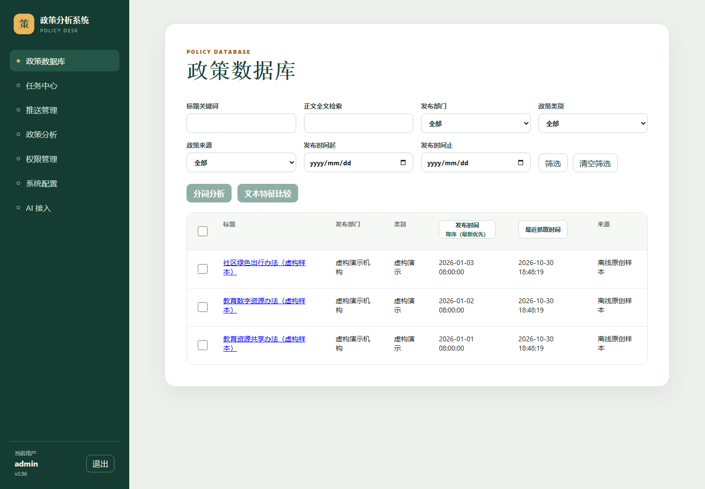
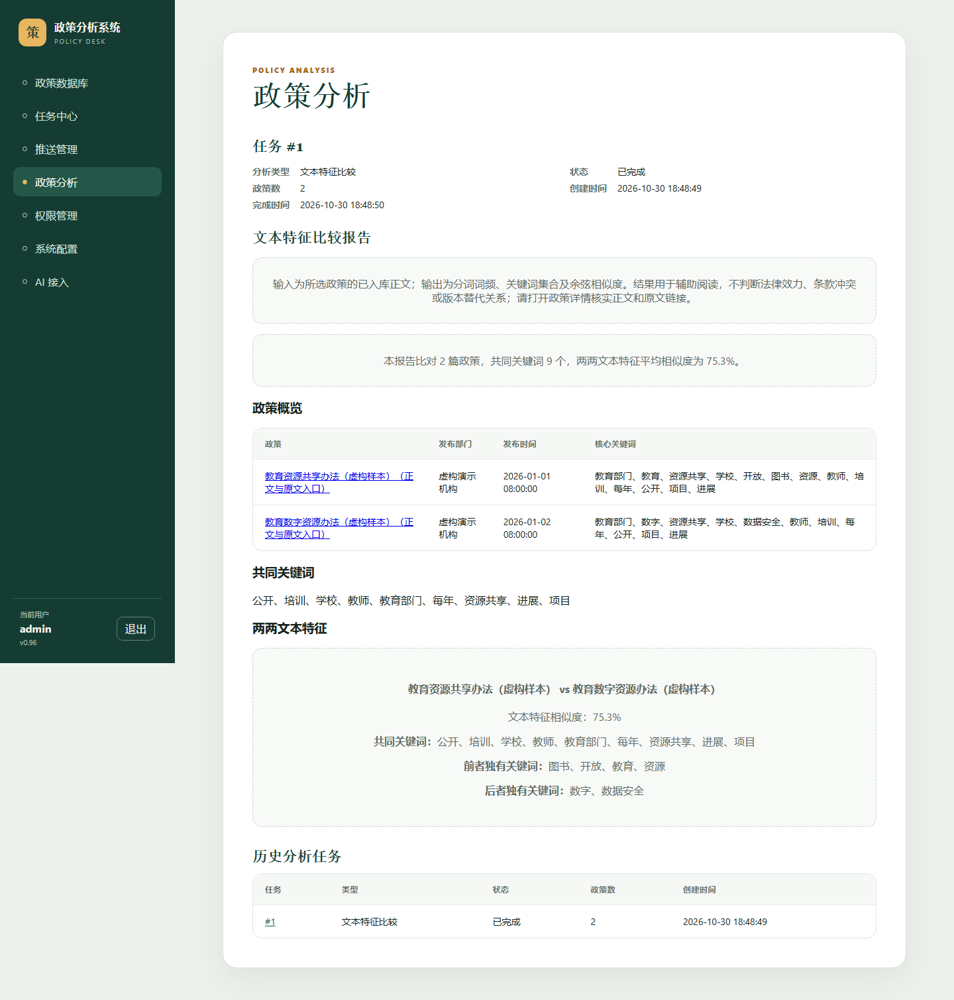

# PolicyAnalysisSystem

使用 FastAPI、Vue 3 和 SQLite 的政策采集与文本分析工具。适合集中整理公开政策正文、按标题与全文检索、观察词频及比较不同文本的关键词特征。支持登录、页面权限、系统配置、任务日志，以及可选的 WebFetch 采集和 AI API / MCP 接入。

## 页面与用途

| 页面 | 输入与输出 |
| --- | --- |
| 政策数据库 | 按标题、全文、部门、类别、来源和时间筛选；查看纯文本正文及原文链接 |
| 政策分析 | 选择正文，生成词频、TF-IDF、词云、关键词关系图及文本特征比较 |
| 任务中心 | 创建或查看采集任务、运行状态、逐篇处理结果和日志 |
| 权限管理 / 系统配置 | 管理可登录用户、可见页面，查看当前配置与 WebFetch 状态 |
| AI 接入 | 管理个人 API / MCP 凭据；见 [接入说明](docs/ai-integration.md) |





## 最短本地体验（离线样本）

需要 Python 3.12、Node.js `^20.19.0 || >=22.12.0` 和 npm。在仓库根目录执行；不需要 WebFetch 或大模型密钥。三份演示正文为原创 MIT 授权的虚构文本，不是真实政策。

Linux / macOS：

```bash
python3.12 -m venv .venv
source .venv/bin/activate
python -m pip install -e '.[dev]'
npm --prefix src/app/frontend ci
npm --prefix src/app/frontend run build
python -m policy_analysis.demo --data-dir ./demo-data
export POLICY_ANALYSIS_DATABASE__PATH="$PWD/demo-data/app.sqlite3"
export POLICY_ANALYSIS_AUTH__PASSWORD_FILE="$PWD/demo-data/password.txt"
uvicorn policy_analysis.main:app --host 127.0.0.1 --port 30080
```

Windows PowerShell：

```powershell
py -3.12 -m venv .venv
.\.venv\Scripts\python.exe -m pip install -e '.[dev]'
npm --prefix src/app/frontend ci
npm --prefix src/app/frontend run build
.\.venv\Scripts\python.exe -m policy_analysis.demo --data-dir .\demo-data
$env:POLICY_ANALYSIS_DATABASE__PATH = Join-Path $PWD 'demo-data/app.sqlite3'
$env:POLICY_ANALYSIS_AUTH__PASSWORD_FILE = Join-Path $PWD 'demo-data/password.txt'
.\.venv\Scripts\python.exe -m uvicorn policy_analysis.main:app --host 127.0.0.1 --port 30080
```

打开 [本地页面](http://127.0.0.1:30080/)，用 `admin` 及 `demo-data/password.txt` 中本地生成的口令登录。请在本地编辑器中查看该文件并妥善保管，不要提交或分享。演示初始化只操作指定目录，重复运行不会重复导入样本，也不会重置已有账号。选择样本后点击「分词分析」或选择至少两篇后点击「文本特征比较」，从任务完成后的报告进入正文与原文入口。

## 文本特征比较的边界

输入是所选政策的已入库正文；输出包括分词词频、关键词集合、共同与各自独有关键词，以及两两余弦相似度。相同且含有效词的正文相似度为 1；空正文没有有效词，余弦相似度为 0。默认保留至少两个字符的词。

这些结果辅助定位阅读重点，不判断法律效力、条款冲突或版本替代关系。关键词未出现不代表相关条款不存在。请从报告中的政策详情查看正文、来源和原文链接，核实上下文；虚构样本的链接仅用于演示。文号、效力状态和版本对齐属于后续研究需求，未知字段不得推断。

## 配置与真实采集

[`src/config/app.json`](src/config/app.json) 保存无密钥配置；优先级为 `POLICY_ANALYSIS_` 环境变量 > JSON > 代码默认值。嵌套字段以 `__` 分隔。数据库和密码文件默认为 `src/data/app.sqlite3`、`src/data/password.txt`；JSON 中的服务端口为 `30080`，直接运行 uvicorn 时以命令行端口为准。真实使用可先取消演示路径环境变量，再执行 `python scripts/initialize_admin.py`，按当前配置生成私有管理员密码文件；已有文件会保留。请在本地读取随机口令，不要复用公开口令。

初始化脚本会读取 `service.env`，同名进程环境变量优先。可通过 `POLICY_ANALYSIS_INITIAL_ADMIN_PASSWORD` 显式设置初始口令；不设置时随机生成。该变量只供初始化使用，不出现在系统配置展示中。既有账号不会被重置。

采集才需要独立部署的 WebFetch v1 服务。Linux 示例（仅占位符）：

```bash
export POLICY_ANALYSIS_WEBFETCH__BASE_URL='http://127.0.0.1:33333'
export POLICY_ANALYSIS_WEBFETCH__API_KEY='replace-with-your-service-key'
```

PowerShell 使用 `$env:POLICY_ANALYSIS_WEBFETCH__BASE_URL = 'http://127.0.0.1:33333'` 和 `$env:POLICY_ANALYSIS_WEBFETCH__API_KEY = 'replace-with-your-service-key'`。密钥从环境注入，不写入版本库。配置后重启应用，再到系统配置查看连接状态；健康探测访问 WebFetch 的 `health/ready`，业务请求使用 Bearer 认证。

可复制的只读健康检查（不发送密钥）：

```bash
curl --fail http://127.0.0.1:30080/health/ready
curl --fail http://127.0.0.1:33333/health/ready
```

如果采集失败，先检查 base URL、网络连通和服务就绪；健康成功仍可能因 API Key 无效导致业务认证失败。再查任务日志中的稳定原因码，区分认证、超时、限流、网页正文不足和服务返回格式不兼容。应用自身的 [存活检查](http://127.0.0.1:30080/health/live) 和 [就绪检查](http://127.0.0.1:30080/health/ready) 不等同于上游业务抓取成功。本文说明来自代码核对，未探测任何私人服务。

## 升级、部署与运维

1. 停止当前服务，备份实际数据库、密码文件、`src/config/app.json` 和部署环境文件；数据库应在停服后复制以保持一致。
2. 更新源码并重新安装 Python 依赖，执行 `npm --prefix src/app/frontend ci` 和 `npm --prefix src/app/frontend run build`。
3. 保留原配置与数据路径，启动应用；启动过程运行数据库迁移。查看日志并检查就绪接口、登录、查询和任务状态。
4. 回滚时停止服务，恢复与旧代码匹配的数据库备份和环境配置，再启动旧版本；不要只降级代码而保留已迁移的数据库。

当前仓库不提供 Docker Compose 启动承诺。Linux systemd、Jenkins 配置及详细采集/API 操作参见 [开发与运维参考](docs/operations.md)；接入前替换为自己的部署环境。部署更新应保留现有配置与数据。

## 验证与文档

```bash
python -m pytest src/tests/backend src/tests/smoke -q
npm --prefix src/app/frontend run type-check
npm --prefix src/app/frontend run lint
npm --prefix src/app/frontend run test -- --run
npm --prefix src/app/frontend run build
npm --prefix src/app/frontend run test:e2e
```

浏览器测试通过网络模拟验证主要页面，不证明外部采集服务可用。详细需求见 [分析规格](openspec/specs/policy-analysis/spec.md)，技术设计见 [系统设计](docs/superpowers/specs/2026-07-31-policy-analysis-system-mvp-design.md)，近期功能见 [CHANGELOG](CHANGELOG.md)。

发布前请阅读 [人工安全操作](docs/open-source-security.md) 与 [本轮验证记录](docs/open-source-validation.md)。

## 许可证与第三方内容

项目代码及原创演示样本采用 [MIT License](LICENSE)。第三方依赖继续遵循各自许可证；抓取的真实政策、网页和图片不会因本项目许可证而自动获得 MIT 授权，使用与再分发时请核实来源及相关权利。
